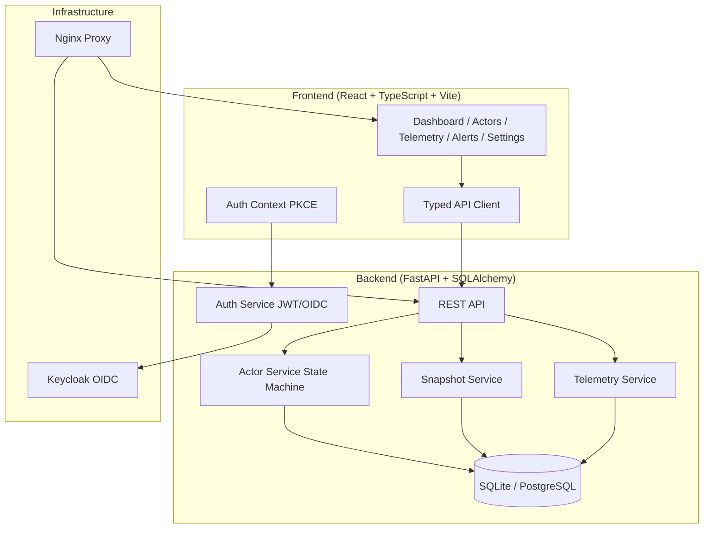

# Orbit Console — Agent Substrate | Ryan Vo | AI & Machine Learning

> Work in progress. This checkpoint may be incomplete or fail tests. See PLAN.md and STATUS.md before use.


Orbit Console is a management and observability platform for **Agent Substrate** — the core system for running dense, suspendable actor workloads. It provides a complete interface for actor lifecycle management, telemetry monitoring, and state machine visualization.

## Problem

Agent Substrate runs millions of actors across heterogeneous runtimes (gVisor, micro-VM). Operators need to:

- Track actor state transitions (RUNNING ↔ PAUSED ↔ SUSPENDED ↔ CRASHED)
- Monitor telemetry with **bounded cardinality** — metrics attributed by template, not actor instance
- Observe per-actor traces/logs without overwhelming storage
- Coordinate cooperative self-suspend for idle actors

## AI/ML Approach

Orbit Console implements the **Actor Otel Telemetry Relay** design (Substrate #853):

- **Trusted attribution**: Platform stamps `ate.dev/*` identity onto telemetry, not the workload
- **Delta temporality**: Self-contained metric exports that survive migration without history
- **Cardinality bounding**: Metrics stripped of unbounded labels (`actor_uid`, `actor_name`, `service.instance.id`, `actor_atespace`); only `actor_template_namespace`, `actor_template_name`, `container_name` retained
- **Exemplar linkage**: Metric datapoints link to traces carrying full identity

The dashboard visualizes `ate.actors` gauge (by status × template) and `ate.actor.crashes` counter — both bounded cardinality by design.

## Intended User

Platform operators and AI/ML engineers managing Agent Substrate deployments who need real-time visibility into actor density, lifecycle latency, scheduling outcomes, and crash patterns.

## Features

- **Actor Lifecycle Management**: Create, pause, resume, commit, revert, dump actors with validated state transitions
- **Telemetry Dashboard**: Real-time `ate.actors` gauge, crash counter, state transition tracking, raw metrics browser
- **Bounded Cardinality**: Template-level metrics (namespace × name × container), per-actor traces/logs only
- **Snapshot Management**: Full (memory + fs) and data-only (durabledir) snapshots with tagging
- **OIDC Authentication**: PKCE flow with Keycloak, role-based access (viewer/operator/admin)
- **Self-Suspend Support**: Actor cooperative yield via `/var/ate/state/suspend`

## Architecture



## Quick Start

### Prerequisites

- Docker 24+ and Docker Compose
- Node 24 (for local frontend dev)
- Python 3.12 (for local backend dev)

### With Docker Compose

```bash
# Copy env template
cp .env.example .env

# Edit .env with your secrets
# Required: SECRET_KEY, KEYCLOAK_ADMIN_PASSWORD, OIDC_CLIENT_SECRET

# Start all services
docker compose up -d

# Access
# Frontend: http://localhost:3000
# Backend API: http://localhost:8000
# Keycloak: http://localhost:8080 (admin/admin)
```

### Local Development

```bash
# Backend
cd backend
python3 -m venv .venv
.venv/bin/pip install -r requirements.txt
.venv/bin/python -m uvicorn app.main:app --reload --host 127.0.0.1 --port 8000

# Frontend (separate terminal)
cd frontend
npm install
npm run dev
```

## Configuration

| Variable | Description | Default |
|----------|-------------|---------|
| `SECRET_KEY` | JWT signing key (32+ chars) | **Required** |
| `DATABASE_URL` | SQLAlchemy URL | `sqlite+aiosqlite:///./orbit.db` |
| `OIDC_ISSUER_URL` | Keycloak realm URL | `http://localhost:8080/realms/orbit` |
| `OIDC_CLIENT_ID` | Keycloak client ID | `orbit-console` |
| `OIDC_CLIENT_SECRET` | Keycloak client secret | **Required** |
| `OIDC_REDIRECT_URI` | Frontend callback URL | `http://localhost:3000/callback` |
| `LLM_API_KEY` | LLM provider key | Optional |
| `LLM_PROVIDER` | Provider type | `openai-compatible` |
| `LLM_MODEL` | Model name | `gpt-4o-mini` |
| `LLM_BASE_URL` | Provider base URL | `https://api.openai.com/v1` |
| `FRONTEND_URL` | CORS origin | `http://localhost:3000` |

## API Reference

### Actors

| Method | Endpoint | Description |
|--------|----------|-------------|
| GET | `/api/v1/actors` | List actors (paginated, filtered) |
| POST | `/api/v1/actors` | Create actor (operator+) |
| GET | `/api/v1/actors/{id}` | Get actor by ID |
| GET | `/api/v1/actors/uid/{uid}` | Get actor by UID |
| PATCH | `/api/v1/actors/{id}` | Update actor metadata |
| DELETE | `/api/v1/actors/{id}` | Delete actor (admin) |
| POST | `/api/v1/actors/{id}/pause` | Pause actor (operator+) |
| POST | `/api/v1/actors/{id}/resume` | Resume actor (operator+) |
| POST | `/api/v1/actors/{id}/commit` | Commit actor (operator+) |
| POST | `/api/v1/actors/{id}/revert` | Revert actor (operator+) |
| POST | `/api/v1/actors/{id}/dump` | Dump crashed actor (operator+) |
| GET | `/api/v1/actors/{id}/snapshots` | List actor snapshots |
| GET | `/api/v1/actors/stats` | Aggregate statistics |

### Telemetry

| Method | Endpoint | Description |
|--------|----------|-------------|
| GET | `/api/v1/telemetry/metrics` | Template metrics (filtered) |
| GET | `/api/v1/telemetry/actors/{id}/telemetry` | Per-actor traces/logs |
| GET | `/api/v1/telemetry/status-gauge` | `ate.actors` gauge data |
| GET | `/api/v1/telemetry/crash-count` | `ate.actor.crashes` counter |
| GET | `/api/v1/telemetry/summary` | Dashboard summary |
| GET | `/api/v1/telemetry/ate-actors` | Prometheus-format gauge |
| GET | `/api/v1/telemetry/ate-actor-crashes` | Prometheus-format counter |

### Auth

| Method | Endpoint | Description |
|--------|----------|-------------|
| GET | `/api/v1/auth/login` | Initiate OIDC flow |
| GET | `/api/v1/auth/callback` | OIDC callback |
| POST | `/api/v1/auth/token` | Token exchange |
| GET | `/api/v1/auth/me` | Current user info |
| POST | `/api/v1/auth/logout` | Logout |
| GET | `/api/v1/auth/config` | OIDC config for frontend |

## SSO / SAML Setup

Keycloak supports SAML identity providers via identity brokering:

1. In Keycloak Admin Console: **Identity Providers → Add Provider → SAML v2.0**
2. Configure IdP metadata (entity ID, SSO URL, certificate)
3. Map SAML attributes to Keycloak claims (email, name, roles)
4. Enable "First Login Flow" to link/update local accounts
5. Update `OIDC_ISSUER_URL` to your realm

## Security Limitations

- **Demo mode**: Local development uses self-signed certificates and relaxed validation
- **Token storage**: Frontend stores access token in localStorage (not httpOnly cookie)
- **PKCE**: Uses plain code challenge method (S256 recommended for production)
- **Rate limiting**: Not implemented — add reverse proxy (nginx/Traefik) for production
- **Audit logging**: Basic — extend for compliance requirements

## LLM Provider Configuration

| Provider | `LLM_PROVIDER` | `LLM_BASE_URL` | Notes |
|----------|----------------|----------------|-------|
| OpenAI | `openai-compatible` | `https://api.openai.com/v1` | |
| Azure OpenAI | `openai-compatible` | `https://{resource}.openai.azure.com` | |
| LiteLLM | `openai-compatible` | `http://litellm:4000` | |
| OpenRouter | `openai-compatible` | `https://openrouter.ai/api/v1` | |
| Ollama | `ollama` | `http://ollama:11434` | |
| Anthropic | `anthropic` | `https://api.anthropic.com` | Messages API |
| Gemini | `gemini` | `https://generativelanguage.googleapis.com` | generateContent |

## Backup / Restore

```bash
# Backup SQLite
docker compose exec backend cp /app/orbit.db /app/backups/orbit-$(date +%F).db

# Restore
docker compose exec backend cp /app/backups/orbit-2026-01-15.db /app/orbit.db
```

For PostgreSQL, use `pg_dump`/`pg_restore`.

## TLS Reverse Proxy

Production deployments should terminate TLS at a reverse proxy:

```nginx
server {
    listen 443 ssl http2;
    server_name orbit.example.com;

    ssl_certificate /etc/letsencrypt/live/orbit.example.com/fullchain.pem;
    ssl_certificate_key /etc/letsencrypt/live/orbit.example.com/privkey.pem;

    location / {
        proxy_pass http://frontend:3000;
        proxy_set_header Host $host;
        proxy_set_header X-Forwarded-Proto https;
    }

    location /api/ {
        proxy_pass http://backend:8000;
        proxy_set_header Host $host;
        proxy_set_header X-Forwarded-Proto https;
    }
}
```

## Development

### Running Tests

```bash
# Backend
cd backend
.venv/bin/python -m pytest tests/ -v

# Frontend
cd frontend
npm test
```

### Code Quality

```bash
# Backend
.venv/bin/ruff check app/ tests/

# Frontend
npm run lint
```

## AI/ML Evaluation

### Reproducible Baseline

The telemetry subsystem implements the Substrate #853 design for bounded-cardinality actor metrics. Evaluation criteria:

1. **Cardinality**: Metrics series count = `templates × containers × metrics` (independent of actor count)
2. **Attribution correctness**: Platform-stamped `ate.dev/*` labels override workload labels
3. **Migration survival**: Delta temporality ensures merged series across workers without history
4. **Crash observability**: `ate.actor.crashes` counter tracks current CRASHED actors by template

### Running Evaluation

```bash
# Start services
docker compose up -d

# Load test data
curl -X POST http://localhost:8000/api/v1/actors \
  -H "Content-Type: application/json" \
  -d '{"uid":"eval-1","name":"Eval Actor","atespace":"prod","template_namespace":"default","template_name":"worker-v1"}'

# Simulate transitions
curl -X POST http://localhost:8000/api/v1/actors/1/resume
curl -X POST http://localhost:8000/api/v1/actors/1/pause
curl -X POST http://localhost:8000/api/v1/actors/1/commit

# Check metrics
curl http://localhost:8000/api/v1/telemetry/ate-actors
curl http://localhost:8000/api/v1/telemetry/ate-actor-crashes
```

### Expected Results

- `ate.actors` gauge shows 4 series per template (running, paused, suspended, crashed)
- `ate.actor.crashes` counter increments only on RUNNING/PAUSED → CRASHED transitions
- Per-actor traces carry full `ate.dev/*` identity; metrics carry only template labels
- State transitions recorded in `ate.actor.transitions` counter with from/to labels

### Failure Cases

- **Gauge race**: Delta temporality doesn't apply to gauges; concurrent actors writing same gauge race on last value (Substrate #853 §6.2)
- **Concurrency**: Shared worker address assumes one-actor-per-worker; breaks if concurrency lands
- **Telemetry loss**: `onPause: Data` kills lose delta window permanently (no cumulative self-heal)

## License

MIT License — Copyright (c) 2026 Ryan Vo <ryandtvo@gmail.com>